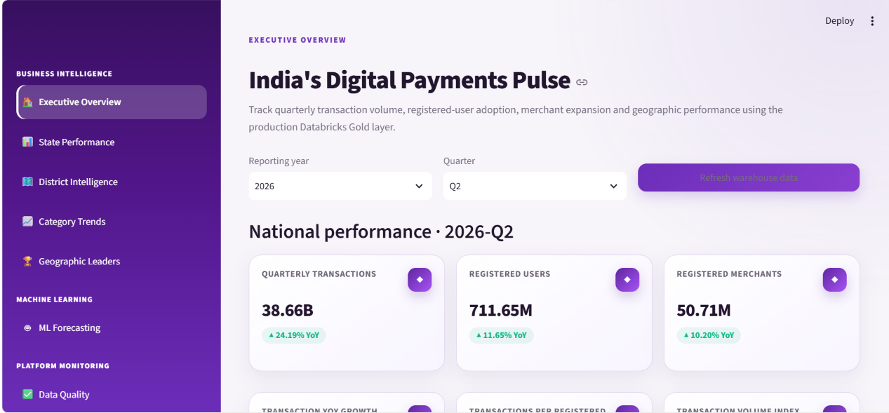
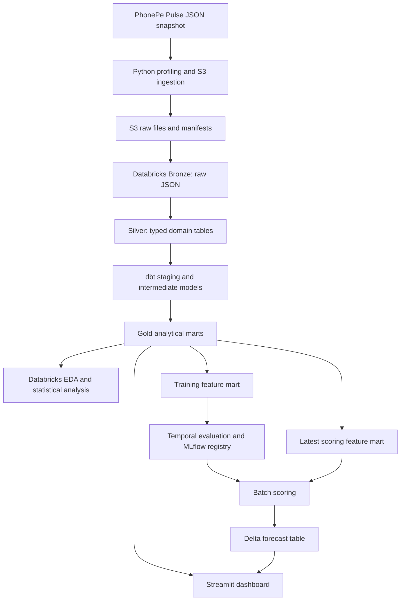
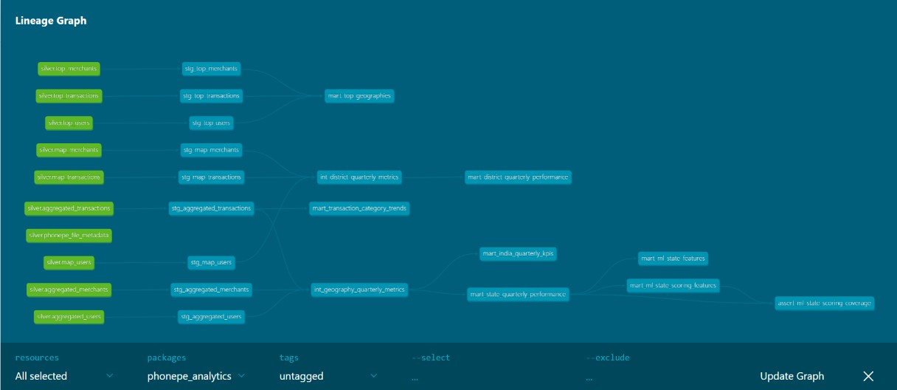
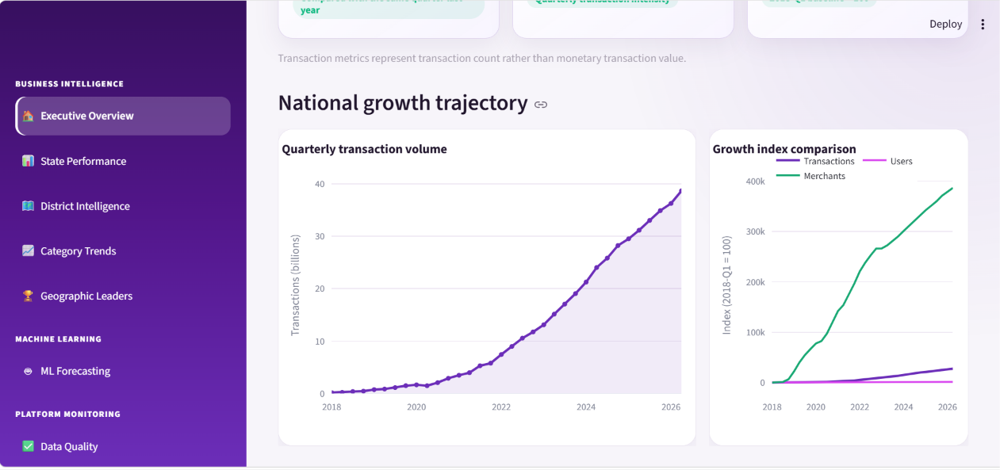
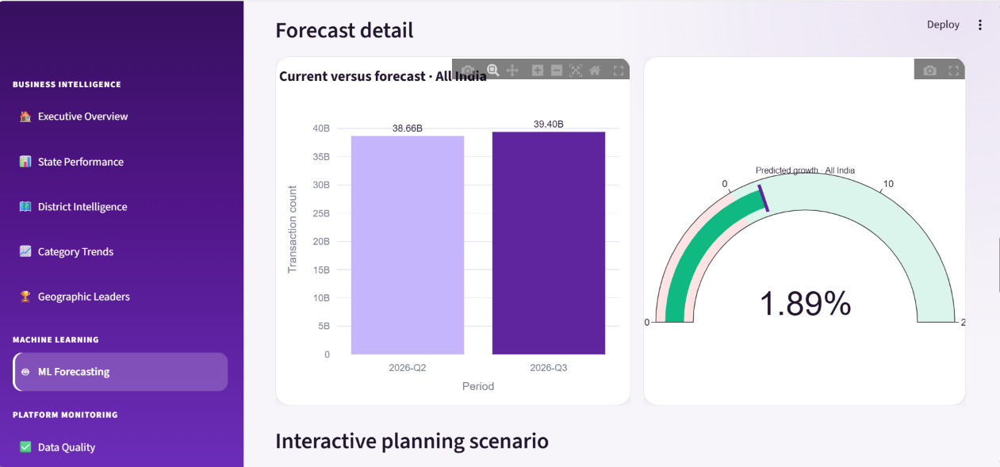
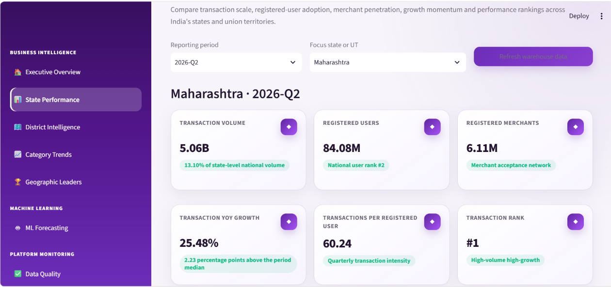
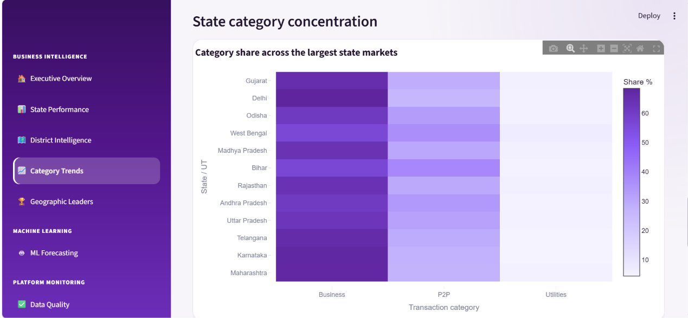
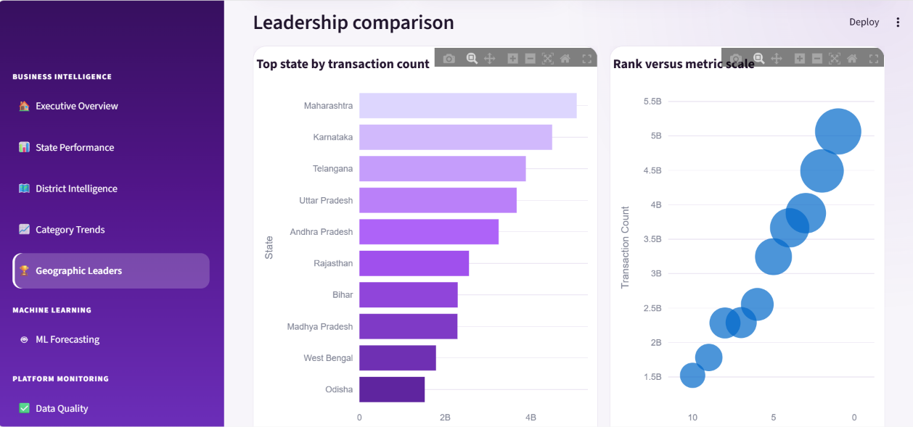
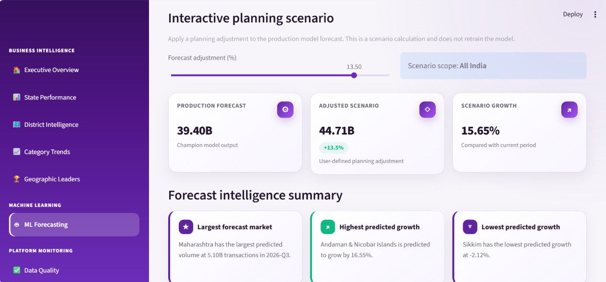

# PhonePe Pulse Lakehouse

### From versioned JSON to geographic intelligence and next-quarter forecasts

An end-to-end portfolio project combining **data engineering, analytics engineering, exploratory analysis and machine learning**. PhonePe Pulse data moves through Amazon S3 and Databricks Delta tables, dbt turns it into reusable analytical models, and a seven-page Streamlit dashboard makes the results interactive.

> Independent educational project. Not affiliated with PhonePe. Findings describe the supplied PhonePe Pulse snapshot, not the entire Indian payments market. Public hosting and scheduled orchestration are not yet part of the verified implementation.



## Project at a glance

| Dimension | Recorded project result |
| --- | --- |
| Source snapshot | 11,184 JSON files; 0 invalid JSON files reported |
| Historical coverage | 2018-Q1–2026-Q2, across 36 states and union territories |
| Source version | `257bf38e3095020f9f516c4c72c10bdc348781b1` |
| dbt graph | 18 models, 10 sources and 307 defined data tests in the supplied docs-generation log |
| Forecasting method | Residual-growth Random Forest, with chronological evaluation |
| Recorded test WMAPE | 2.82%, compared with 5.30% for last-quarter naive |
| Relative error reduction | 46.86%, calculated using unrounded scores |
| Batch forecast | 36 state/UT forecasts for 2026-Q3 |
| Presentation | Seven interactive Streamlit pages |

**Evidence note:** defined tests are not the same as passed tests. The latest supplied `dbt docs generate` log confirms discovery and catalog generation, not a full-suite test run. ML figures are recorded notebook results; see the [model card](docs/MODEL_CARD.md) for evaluation and deployment-parity qualifications.

## What questions does this project answer?

- How have quarterly and complete-year PhonePe transaction counts changed?
- Which states lead in transaction scale, and which are growing faster?
- How do transaction value, registered-user counts and merchant counts vary across districts?
- How does the transaction-category mix differ between states?
- Can a model improve next-quarter forecasts over simply repeating the latest quarter?
- How can the same governed datasets support analytical exploration and a dashboard?

## Architecture



The diagram describes the project workflow; it is not a claim that an automated scheduler currently runs it. **dbt builds business logic and tests. Databricks notebooks perform EDA, model training and batch scoring. Streamlit presents the resulting tables.**

### Technology responsibilities

| Technology | Responsibility |
| --- | --- |
| Python | Source profiling, ingestion and ML/data preparation |
| Amazon S3 | Versioned raw-data layout and ingestion manifests |
| Databricks / PySpark / Delta | Bronze and Silver transformations, analytical execution and forecast storage |
| dbt Core / dbt-databricks | SQL transformations, data tests, documentation and model dependencies |
| pandas / NumPy / SciPy / Matplotlib | Exploration, statistical tests and diagnostic charts |
| scikit-learn | Preprocessing, candidate models and residual-growth forecasting |
| MLflow / Unity Catalog | Model logging, signatures, version registration and Champion alias |
| Streamlit / Plotly | Interactive analytical interface |
| Git | Version-controlled implementation and documentation |

## Data design

### Bronze and Silver

Bronze retains raw JSON in `workspace.bronze.phonepe_raw_json`. Silver separates file metadata from domain records:

- `phonepe_file_metadata`
- `aggregated_transactions`, `aggregated_users`, `aggregated_merchants`
- `map_transactions`, `map_users`, `map_merchants`
- `top_transactions`, `top_users`, `top_merchants`

Aggregated data supports national/state summaries and transaction categories. Map data supports geographic comparisons, including district transaction amounts. Top data preserves source-provided ranked subsets; it is not a complete census of every geography.

### Gold data products

| Model | Grain / purpose |
| --- | --- |
| `mart_india_quarterly_kpis` | One national row per quarter; growth, ratios and baseline indices |
| `mart_state_quarterly_performance` | State/UT × quarter; scale, growth and ranks |
| `mart_district_quarterly_performance` | State × district × quarter; counts, amounts, ratios and coverage flags |
| `mart_transaction_category_trends` | Scope × geography × quarter × category; count, share and growth |
| `mart_top_geographies` | Domain × scope × geography level × parent state × entity × quarter × source rank |
| `mart_ml_state_features` | Eligible state × feature quarter, with observed next-quarter label |
| `mart_ml_state_scoring_features` | Eligible states in the latest eligible feature quarter; next-quarter date, no observed target required |

The two intermediate models combine transaction, user and merchant records using a union of keys followed by left joins. This retains incomplete records rather than silently dropping them. Availability flags distinguish missing data from a genuine zero.

### Actual dbt lineage



The supplied dbt graph covers sources and SQL models, including the training/scoring feature branches. Python ingestion, notebook training and dashboard queries sit outside that graph unless additional lineage integration or dbt exposures are added.

## Analytics and findings

The EDA notebook examines national trends, complete-year comparisons, geographic differences, concentration, growth relationships and district catch-up.

| Recorded finding | Interpretation |
| --- | --- |
| 2026-Q2: 38.66 billion transactions | Latest observed national quarterly count in this snapshot |
| 2026-Q2: 711.65 million registered users | Registered users, not quarterly active users |
| 2026-Q2: 50.71 million registered merchants | Registration measure, not necessarily active merchants |
| 2025: 128.54 billion transactions; 29.41% YoY growth | Complete-year comparison; 2026 is only partially observed |
| District catch-up p-value: 0.485432 | Insufficient evidence of a difference in the two growth distributions |

For district catch-up, the notebook compares 2025-Q2 to 2026-Q2, splitting matched districts at the prior-year median count. The median growth difference was approximately **0.216 percentage points**, with a bootstrap 95% interval of **−1.322 to 1.553 percentage points**. This is not evidence of convergence or a causal effect. State correlations use a Benjamini–Hochberg adjustment across ten comparisons.



### Rules for reading the metrics

1. Do not add national totals to state totals: they describe overlapping activity.
2. Transaction count is not transaction value. Amounts are available in the map transaction branch used for district analysis.
3. Registered users and merchants are stock-like measures: do not sum their quarterly snapshots to obtain an annual population.
4. Missing source records remain missing; absence must not automatically become zero.
5. Transactions per registered user are an aggregate intensity ratio, not a measured average for active individuals.
6. Rank comparisons must respect their scope and parent geography.
7. Quarterly window offsets require calendar-continuity validation before being interpreted as exact QoQ or YoY changes.

## Machine learning

### Predict growth, then reconstruct the transaction count

For state `s` and observed quarter `t`, the residual model learns:

```text
growth_target = log(transactions[s, t+1] / transactions[s, t])
forecast[s, t+1] = transactions[s, t] × exp(predicted_growth)
```

This retains the current transaction scale as the baseline and asks the model to learn the next-quarter change. The 22 input features include state identity, current counts, ratios, ranks, one-to-four-quarter transaction lags, historical rolling statistics, growth rates and calendar features.

The workflow first compares naive baselines and direct regressors, then residual models. An eight-configuration Random Forest search uses three expanding-window folds. The selected configuration uses **300 trees, maximum depth 8, minimum leaf size 3, maximum feature fraction 0.8 and random seed 42**.

| Evaluation stage | Target periods / result |
| --- | --- |
| Initial validation | 2024-Q3–2025-Q2 |
| Rolling validation | Three yearly validation blocks ending 2023-Q2, 2024-Q2 and 2025-Q2 |
| Final fitting | 2021-Q1–2025-Q2; 648 state-quarter rows |
| Held-out evaluation | 2025-Q3–2026-Q2; 144 rows |
| Mean rolling WMAPE | 5.01% |
| Recorded held-out WMAPE | Random Forest 2.82%; last-quarter naive 5.30% |

This is **one-quarter-ahead evaluation using each quarter's observed inputs**, not a four-quarter forecast made at a single origin. A 2.82% WMAPE is not “97.18% accuracy.” Large states have greater influence on this volume-weighted metric; state-level errors must also be reported.

### Batch inference

The registered model `workspace.ml.phonepe_state_transaction_forecaster` is loaded through its `Champion` alias. Scoring validates 36 complete state/UT inputs and saves forecasts to `workspace.ml.state_transaction_forecasts`, using a Delta merge keyed by state, target period and model version.

The recorded version-1 batch used 2026-Q2 features to estimate **39.40 billion transactions for 2026-Q3**, a **1.89%** increase over the observed Q2 baseline. This is a stored model estimate, not a verified Q3 actual or a currently refreshed forecast. Its issue timing and source publication lag must be disclosed before claiming a prospective forecast.



The dashboard's scenario slider applies a user-selected percentage adjustment to the stored forecast. **It does not retrain the model, produce a confidence interval or estimate a causal business intervention.**

Read the [model card](docs/MODEL_CARD.md) for limitations and the [publication checklist](docs/PUBLICATION_CHECKLIST.md) before reusing performance claims.

## Dashboard tour

| Page | User-facing purpose |
| --- | --- |
| Executive Overview | National quarterly KPIs and historical trends |
| State Performance | State selection, growth, scale and relative position |
| District Intelligence | District-level counts, amounts, intensity and comparisons |
| Category Trends | Transaction mix and state category concentration |
| Geographic Leaders | Source-ranked geographic subsets by metric |
| ML Forecasting | Stored predictions, predicted growth and planning scenarios |
| Data Quality | Data coverage and platform context, plus historical model evaluation |









Screenshots show the development application. They do not establish that the app is publicly hosted. A dashboard refresh reads the available tables; it does not itself ingest new source data or retrain a model.

## Running the existing project

This is a cloud-backed application, not a standalone repository-only demo. It requires configured AWS/Databricks access, populated tables and an accessible registered model. Keep credentials outside version control.

### Local dashboard — Git Bash on Windows

From the repository root:

```bash
source .venv/Scripts/activate
cd streamlit_app
python -m pip install -r requirements.txt
streamlit run app.py
```

Use the connection settings required by `services/databricks_client.py` in a local, ignored `.streamlit/secrets.toml`. Do not publish that file or paste credentials into source code.

### dbt validation and documentation

From the repository root, with the virtual environment activated and the dbt profile configured:

```bash
cd phonepe_analytics
read -s -p "Databricks token: " DATABRICKS_TOKEN
export DATABRICKS_TOKEN
echo
dbt debug
dbt build
dbt docs generate
dbt docs serve --port 8080
```

Open `http://localhost:8080`. The token prompt is hidden. Do not commit the token, local profiles containing credentials, or unreviewed notebook outputs. `dbt build` rebuilds selected resources and can consume warehouse quota; documentation generation is not a substitute for it.

### Refresh order

1. Select and record the new source commit; profile the snapshot.
2. Upload raw data and its manifest; run Bronze and Silver processing.
3. Build and test the dependent dbt models, including scoring features.
4. Run the batch-scoring notebook with the intended model version.
5. Validate the saved forecast batch and refresh the dashboard cache.
6. Retrain separately when justified; compare and validate before changing Champion.

Airflow is intentionally deferred. See the [runbook](docs/RUNBOOK.md) for operational boundaries.

## Repository areas

| Area | Contents |
| --- | --- |
| `src/ingestion/` | Raw upload implementation |
| `src/validation/` | Source profiling |
| `config/` | Source version metadata; local secrets must remain ignored |
| `databricks/` | Bronze/Silver, EDA and ML notebooks |
| `phonepe_analytics/` | dbt models, tests and macros |
| `streamlit_app/` | Application, services, components and views |
| `docs/` | Model card, runbook, publication checklist and screenshots |

## Engineering decisions and current boundaries

- **Traceability:** retain the source commit, source paths and ingestion metadata.
- **Reusable logic:** business transformations live in dbt rather than being duplicated in charts.
- **Missingness:** union-of-keys joins and availability flags preserve incomplete coverage.
- **Train/score separation:** scoring does not require an observed future target.
- **Model governance:** logged signature, registered version, Champion alias and saved forecasts.
- **Practical scope:** small data volume, manual batch execution and local dashboard; no claim of large-scale throughput or enterprise SLA.

Remaining work includes deployed-model/evaluation parity checks, formatter corrections, full-suite test evidence, calendar-continuity checks, public-hosting security and scheduled orchestration. Power BI is a separate planned consumption layer, not part of the verified dashboard implementation.

## Research direction

Potential study: **“Baseline-relative forecasting of regional digital-payment activity using a reproducible lakehouse pipeline.”**

The current work is a reproducible case-study foundation, not a completed peer-reviewed paper. A stronger research submission needs a literature review, explicit research questions, release-time-aware backtesting, uncertainty estimates, ablations, sensitivity to the 2021 training cutoff, spatial/temporal dependence handling and an untouched future evaluation after any test-informed changes.

See [publication readiness](docs/PUBLICATION_CHECKLIST.md). Pipeline complexity alone does not establish research novelty.

## Attribution and licensing

Source repository: [PhonePe Pulse](https://github.com/PhonePe/pulse). Preserve its attribution and review the license associated with the pinned snapshot before redistributing data or derived public downloads. The project does not grant rights to PhonePe branding or source data. Choose a separate license for original project code before public release.

## Documentation evidence

Prepared from the supplied intermediate/mart SQL, YAML test definitions, four custom test macros, EDA/ML/scoring notebooks, dashboard screenshots and project execution logs. Staging definitions, ingestion implementations and full Streamlit source were not included in this documentation review; those portions are described from the supplied project record rather than independently executed. Cloud jobs were not rerun to produce this documentation.
